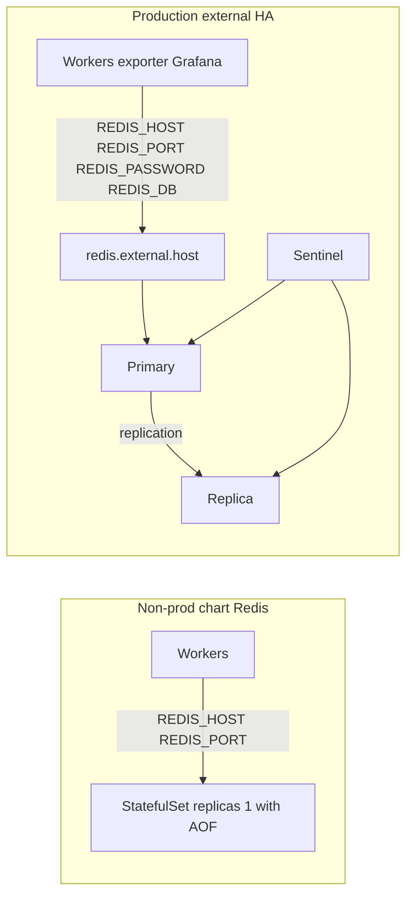

# Kubernetes Deployment - Scraping Pipeline

This directory contains Kubernetes manifests for deploying the UConn Scraping Pipeline.

**Supported install path: the Helm chart** (`helm/scraping-pipeline`, below).
`deployment.yaml` is a minimal quick-start: stage1/stage2 workers and Redis, with no Postgres, Kafka, monitoring or network policies.
It keeps probe parity with the chart (#181):
- **Liveness:** `python -m src.utils.probe alive <worker>`.
- **Readiness:** `python -m src.utils.probe ready-redis`.
- **Shutdown:** a preStop grace sleep.

`src/utils/probe.py` is stdlib-only, because the `python:3.11-slim` image has no `pgrep`.

## Quick Start

```bash
# 1. Create namespace
kubectl create namespace scraping-pipeline

# 2. Create secrets
kubectl create secret generic postgres-credentials \
  --from-literal=password='YOUR_PASSWORD' \
  -n scraping-pipeline


kubectl create secret generic grafana-credentials \
  --from-literal=admin-user='admin' \
  --from-literal=admin-password='YOUR_PASSWORD' \
  -n scraping-pipeline

# 3. Customize values
cp helm/scraping-pipeline/values.yaml values-custom.yaml
# Edit values-custom.yaml with your settings

# 4. Install
helm install scraping-pipeline helm/scraping-pipeline \
  -f values-custom.yaml \
  -n scraping-pipeline
```

## Directory Structure

```
k8s/
├── helm/
│   └── scraping-pipeline/         # Helm chart
│       ├── Chart.yaml             # Chart metadata
│       ├── values.yaml            # Default values
│       ├── values-tenant.example.yaml  # Per-tenant quota and LimitRange (#676)
│       └── templates/             # Kubernetes manifests
│           ├── _helpers.tpl       # Template helpers
│           ├── secrets.yaml       # Secret management
│           ├── redis-statefulset.yaml
│           ├── kafka-statefulset.yaml
│           ├── scrapy-deployment.yaml
│           └── delta-lake-pvc.yaml
└── README.md                      # This file
```

Detailed deployment steps: [../DEPLOYMENT.md](../DEPLOYMENT.md#kubernetes-deployment).

## Architecture

### Stateful Services (StatefulSets)
- **Redis**: Message queue and seen-sets. Non-prod is 1 replica with AOF (not HA). Production uses an external endpoint (`values-prod.yaml`, #216).
- **PostgreSQL**: Metrics database (1 replica)
- **Zookeeper**: Kafka coordination (1 replica)
- **Kafka**: Event streaming (1+ replicas)

- **Prometheus**: Metrics collection (2 replicas for HA)
- **Alertmanager**: Alert management (3 replicas for HA)
- **Grafana**: Dashboards (1 replica)

### Stateless Services (Deployments)
- **Scrapy App**: Web crawling (scalable)
- **Stage 2 Worker**: Page analysis (scalable)
- **Stage 3 Worker**: Summarization (scalable)
- **Stage 4 Worker**: Large documents / PDF + OCR (`stage4Worker`, **off by default**; see below)
- **Kafka Delta Ingestor**: Streaming to Delta Lake (scalable)
- **Metrics Exporter**: Custom metrics (1 replica)
- **Exporters**: Redis, PostgreSQL, Kafka JMX, StatsD

## Per-tenant namespaces

`templates/resourcequota.yaml` renders one [ResourceQuota](helm/scraping-pipeline/templates/resourcequota.yaml) in the release namespace when `namespaceQuota.enabled` is true (the default). A ResourceQuota counts only pods in that namespace. Sharing `scraping-pipeline` across tenants shares one quota; the chart does not split it.

Use one namespace and one Helm release per tenant. Copy [values-tenant.example.yaml](helm/scraping-pipeline/values-tenant.example.yaml), set that tenant's `namespaceQuota.hard`, and install into the tenant namespace. Helm loads `values.yaml` first; the example only overlays the quota and the LimitRange.

```bash
kubectl create namespace tenant-a
helm upgrade --install scraping-pipeline helm/scraping-pipeline \
  -n tenant-a \
  -f helm/scraping-pipeline/values-tenant.example.yaml
```

Repeat for `tenant-b` with its own copy of the file when the caps differ. Do not install two tenants into one namespace. Do not commit passwords into the values file. Clients keep `REDIS_HOST`, `REDIS_PORT`, `REDIS_PASSWORD`, and `REDIS_DB`. Do not set `REDIS_URL`.

The example sets `limitRange.enabled=true`, which renders `templates/limitrange.yaml`. A default install does not pass that flag, so it does not render a LimitRange. The sample LimitRange is per container:

| | Sample |
|---|---|
| ResourceQuota requests | 8 CPU, 32Gi (same compute as `values.yaml`) |
| ResourceQuota limits | 16 CPU, 64Gi |
| Pods / PVCs / Services | 80 / 20 / 40 |
| LoadBalancer and NodePort Services | 0 |
| LimitRange default request | 100m, 128Mi |
| LimitRange default limit | 500m, 512Mi |
| LimitRange max | 2 CPU, 8Gi |
| LimitRange min | 50m, 64Mi |

`requests.storage` is omitted, so storage stays uncapped until you set it. The compute numbers match the shared-namespace default and do not cover every replica at HPA max; raise `namespaceQuota.hard` or turn workloads off. `limitRange.max` covers the largest container in `values.yaml` (Prometheus at 2 CPU and 8Gi). Raise it before any container limit goes above that. `limitRange.min` is under the smallest chart request (exporters at 100m / 128Mi).

A smaller tenant that does not run in-chart data stores can start from the commented quota in the example (2 CPU / 4Gi requests, 4 CPU / 8Gi limits, 20 pods) and set `redis.enabled`, `kafka.enabled`, and `postgresql.enabled` to false. Production still must not use the chart's single-replica Redis; point `redis.external.host` at the shared endpoint (#216).

## Configuration

### Image Registry

Update in `values-custom.yaml`:
```yaml
scrapyApp:
  image:
    repository: your-registry.com/scraping-pipeline/scrapy-app
    tag: v1.0.0
```

### Storage

Ensure your cluster has:
1. **ReadWriteOnce** storage for StatefulSets (standard SSD)
2. **ReadWriteMany** storage for Delta Lake (NFS, EFS, etc.)

```yaml
global:
  storageClass: "fast-ssd"

deltaLake:
  persistence:
    storageClass: "efs-sc"  # Must support ReadWriteMany
```

### Secrets

**Production**: Use External Secrets Operator or your cloud provider's secret manager.

```yaml
secrets:
  useExternalSecrets: true
  externalSecretsProvider: "aws-secrets-manager"
```

### Scaling

```yaml
# Horizontal scaling
scrapyApp:
  replicaCount: 3

stage2Worker:
  replicaCount: 5

# Resource scaling
scrapyApp:
  resources:
    limits:
      cpu: 16000m
      memory: 32Gi
```

### Deploying stages separately (`start.py --stage`)

`python start.py --env k8s --stage <stage>` deploys one stage as its own release and
namespace. Every stage sets all four workload toggles explicitly, so a stage release
never depends on chart defaults (#504):

| `--stage` | scrapyApp | stage2Worker | stage3Worker | stage4Worker |
|---|---|---|---|---|
| `stage1` | on | off | off | off |
| `stage2` | off | on | off | off |
| `stage3` | off | off | on | off |
| `stage4` | off | off | off | on |
| `all-stages` | one release per row above (stage1 → stage4) | | | |
| `pipeline` (default) | chart defaults: Stage 4 off | | | |

Stage 4 needs an image with the PDF/OCR toolchain (`stage4Worker.image`), so it's off
in `values.yaml`. Include it in a full-pipeline release with
`--set stage4Worker.enabled=true`. Preview any of these without touching the cluster:
`python start.py --env k8s --stage stage4 --dry-run`.

## Monitoring

### Prometheus Metrics

Access Prometheus:
```bash
kubectl port-forward svc/scraping-pipeline-prometheus-a 9090:9090 -n scraping-pipeline
```

#### What gets scraped (#789)

The bundled Prometheus uses its own scrape config (no prometheus-operator, so
no ServiceMonitor). Pod annotations are set too, for an external
annotation-based Prometheus.

| Job | Target | Port | Discovery |
|-----|--------|------|-----------|
| `scrapy_app` | Scrapy pods | 9410-9419 | Service + `prometheus.io/*` annotations |
| `stage2_worker`, `stage3_worker` | every worker pod | `workerMetrics.port` (9430) | headless `<release>-stageN-metrics` Service, `dns_sd_configs` (one target per replica) + `prometheus.io/*` annotations |
| `scraping_pipeline` | metrics-exporter | 9100 | Service |
| `redis`, `postgres`, `kafka_jmx` | exporters | 9121 / 9187 / 5556 | Service |
| `statsd` | statsd-exporter (kafka-delta-ingestor pushes StatsD) | 9102 | Service |

Workers start the endpoint from `src/utils/worker_metrics.py`
(`WORKER_METRICS_ENABLED`, `WORKER_METRICS_PORT`, `WORKER_METRICS_ADDR`); a
port clash is logged and the worker keeps consuming. Set
`workerMetrics.enabled=false` to drop the port, annotations, Services and jobs.
With `networkPolicy.enabled=true`, each target gets a
`<target>-metrics-ingress` policy admitting only Prometheus on its metrics
port(s); default-deny previously blocked every scrape.

### Grafana Dashboards

Grafana's Service defaults to **ClusterIP** (#233). Do **not** flip it to
`LoadBalancer` without SSO or an IP allowlist: that puts the admin UI on a public
address. Reach it with:

```bash
kubectl port-forward svc/scraping-pipeline-grafana 3000:3000 -n scraping-pipeline
# or via the TLS ingress below (values-prod.yaml)
```

`profile: production` (or `-f values-prod.yaml`) **fails to render** when Grafana is a
LoadBalancer without `grafana.service.allowPublicLoadBalancer=true`, or when the
ingress is enabled without `ingress.tls` (#451). See the Security section.

### Logs

```bash
# View scrapy logs
kubectl logs -f deployment/scraping-pipeline-scrapy -n scraping-pipeline

# View all logs for a component
kubectl logs -f -l app.kubernetes.io/component=scrapy -n scraping-pipeline
```

### Graceful shutdown and Kafka delivery

On SIGTERM, Scrapy closes the spider and `KafkaPipeline` flushes the producer
for `KAFKA_CLOSE_FLUSH_TIMEOUT` seconds (default 30). Anything still
undelivered after that, plus produce/delivery failures during the crawl, is
written to `KAFKA_SPILL_DIR/<topic>.jsonl` (default `data/kafka_spill/`) and
counted in `kafka_produce_failures_total{reason}` /
`kafka_spilled_messages_total`, instead of being dropped.

Keep `scrapyApp.terminationGracePeriodSeconds` (Helm default 120) comfortably
above that flush timeout plus the rest of spider shutdown. If the kubelet
SIGKILLs the pod mid-flush, neither the flush nor the spill can finish. Put
the spill directory on a persistent volume if spilled messages must survive
pod replacement.

## Upgrading

```bash
# Update image tags in values-custom.yaml
# Then upgrade
helm upgrade scraping-pipeline helm/scraping-pipeline \
  -f values-custom.yaml \
  -n scraping-pipeline
```

## Uninstall

```bash
# Delete Helm release
helm uninstall scraping-pipeline -n scraping-pipeline

# Delete namespace and all resources
kubectl delete namespace scraping-pipeline
```

## Documentation

- **[DEPLOYMENT.md](../DEPLOYMENT.md#kubernetes-deployment)**: Comprehensive deployment guide
- **[values.yaml](helm/scraping-pipeline/values.yaml)**: Configuration options
- **[Chart.yaml](helm/scraping-pipeline/Chart.yaml)**: Chart metadata

## Security

- **Grafana:** ClusterIP by default; prefer the TLS ingress in `values-prod.yaml`
  (cert-manager annotation + `ingress.tls`). Never leave a LoadBalancer on without
  SSO / an IP allowlist (#233 / #451).
- **Kafka durability:** the chart ships RF=1 for a single local broker. Production
  must use `values-prod.yaml` (3 brokers, RF=3, minISR=2). Producers already use
  `acks=all` (#174); with RF=1 that only waits for the leader (#176).
- **NetworkPolicy (#190):** `values-prod.yaml` sets `networkPolicy.enabled=true`
  (default-deny ingress and egress). Scrapers and stage workers may reach Redis,
  Kafka and Postgres, and may open public TCP 80/443 only (not RFC1918 or
  link-local — see `networkPolicy.scrapeExcept`). Prometheus may scrape metrics
  ports. Exporters may dial the store they scrape. Grafana's ingress is limited
  to `networkPolicy.ingressNamespace` (the overlay uses `ingress-nginx`).
  `kubectl port-forward` does not traverse NetworkPolicy.
  **Break-glass:** if a flow is denied and port-forward is not enough, upgrade
  with `--set networkPolicy.breakGlass=true`. That is the only way
  `profile=production` renders with policies off. It drops every NetworkPolicy
  in this chart. Turn it off on the next upgrade; do not commit it.
  Alertmanager Slack/PagerDuty receivers are not given egress; add a rule before
  enabling them.
  Grafana may egress public HTTPS (TCP 443) with the same `networkPolicy.scrapeExcept`
  CIDRs (10/8, 172.16/12, 192.168/16, 169.254/16) so the stock `grafana/grafana`
  image can install `redis-datasource` from grafana.com. The plugin is not baked
  into the image. That allow does not open RFC1918 or link-local, and it does not
  give Alertmanager receivers egress.
- **Secrets:** never put credentials in values committed to git; use
  `existingSecret` (Grafana) and Kubernetes Secrets. See the root `SECURITY.md`.

## Support

For issues or questions:
1. Check pod logs: `kubectl logs <pod-name> -n scraping-pipeline`
2. Check events: `kubectl get events -n scraping-pipeline`
3. Verify resources: `kubectl get all -n scraping-pipeline`
4. Review configuration: `helm get values scraping-pipeline -n scraping-pipeline`

## Development vs Production

### Development

Stage 1–4 sizing (dev / small / prod) is the table in [DEPLOYMENT.md](../DEPLOYMENT.md#helm-resource-profiles). `values.yaml` is dev, `values-small.yaml` is one replica with HPA off, and `values-prod.yaml` raises worker memory so a Kafka lag spike does not OOM the pod. Every enabled workload sets requests and limits; the chart fails the render otherwise.

```yaml
# Example only: smaller Redis for a local cluster. Not a stage-worker profile.
redis:
  persistence:
    enabled: false
  resources:
    requests:
      cpu: 100m
      memory: 128Mi
    limits:
      cpu: 500m
      memory: 512Mi
```

### Production

Use the production overlay (TLS for Grafana, Kafka RF=3 / minISR=2, ClusterIP Grafana):

```bash
helm upgrade --install scraping-pipeline ./k8s/helm/scraping-pipeline \
  -f ./k8s/helm/scraping-pipeline/values.yaml \
  -f ./k8s/helm/scraping-pipeline/values-prod.yaml \
  --set ingress.hosts[0].host=grafana.example.edu \
  --set ingress.tls[0].hosts[0]=grafana.example.edu \
  -n scraping-pipeline
```

Break-glass while debugging a denied flow (revert on the next upgrade; `kubectl port-forward` does not need this):

```bash
helm upgrade --install scraping-pipeline ./k8s/helm/scraping-pipeline \
  -f ./k8s/helm/scraping-pipeline/values.yaml \
  -f ./k8s/helm/scraping-pipeline/values-prod.yaml \
  --set networkPolicy.breakGlass=true \
  -n scraping-pipeline
```

`values-prod.yaml` also sets `profile: production`, which turns the exposure,
durability and network-policy checks into hard render failures (#176 / #233 / #451 / #190):

| Guardrail | Development default | Production requirement |
|---|---|---|
| Grafana Service | ClusterIP | ClusterIP (or LoadBalancer only with `allowPublicLoadBalancer`) |
| Ingress TLS | empty (plain HTTP ok locally) | non-empty `ingress.tls` + cert-manager annotation example |
| Kafka RF / ISR | 1 / 1 | RF ≥ 2 (3 recommended), `minInsyncReplicas` = RF − 1, `kafka.replicas` ≥ RF |
| NetworkPolicy | off | default-deny (`networkPolicy.enabled=true`); `breakGlass=true` only while debugging |
| Redis | in-chart StatefulSet, 1 replica | `redis.enabled=false` and `redis.external.host` (#216) |

### Redis availability (#216)

The chart Redis (`templates/redis-statefulset.yaml`) is a single replica with AOF (`appendonly yes`). Non-prod keeps that StatefulSet. **AOF can recover data after the node returns, and it does not keep the queue available during node loss.**

| | Single-replica chart Redis | Production external endpoint |
|---|---|---|
| RPO | After the node returns, AOF replay restores writes Redis had already fsynced. This chart does not set `appendfsync`, so Redis's default `everysec` applies: about one second of writes can be missing. | Whatever the external service promises. |
| RTO | The queue and seen-sets are unavailable until that same node and its volume are back. There is no failover. | Failover time of the managed Redis or Sentinel deployment you run outside this chart. |

`profile: production` refuses to render when `redis.external.host` is empty or `redis.enabled` is still true. The overlay writes `redis.external.host` to `REDIS_HOST` and `redis.external.port` to `REDIS_PORT`. `REDIS_PASSWORD` still comes from the `redis-credentials` Secret. `REDIS_DB` stays the process default (`0`) unless you set it on the process. Do not set `REDIS_URL`. This chart does not speak the Sentinel wire protocol; point `REDIS_HOST` at a hostname that already reaches the primary (managed Redis, or a name you keep on the current primary).

NetworkPolicy is on in `values-prod.yaml` and cannot match a DNS name. Set `redis.external.egressCIDRs` to the endpoint's CIDRs or default-deny drops the Redis port. Replace `redis.example.edu` and the documentation range `203.0.113.0/24` (TEST-NET-3) before you install.

```yaml
redis:
  enabled: false
  external:
    host: redis.prod.example.edu   # hostname only
    port: 6379
    egressCIDRs:
      - 10.1.2.0/24                # CIDR of that endpoint
```

Sentinel (or any other HA Redis) stays outside this chart. Clients keep using `REDIS_HOST`, `REDIS_PORT`, `REDIS_PASSWORD`, and `REDIS_DB`.



## Requirements

- Kubernetes 1.24+
- Helm 3.10+
- kubectl configured
- Container registry access
- Minimum: 16 CPUs, 32GB RAM, 500GB storage
- Recommended: 32 CPUs, 64GB RAM, 1TB+ storage
