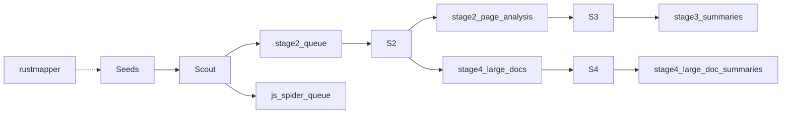

# Pipeline stage map

Canonical end-to-end stage map for the Scrapy crawl pipeline. It complements
[docs/ROADMAP.md](ROADMAP.md)
([#370](https://github.com/BenjaminSRussell/Scrapy/issues/370)), which is the
shared product sequence and not a stage-by-stage map. This file is the in-repo
copy of
[#606](https://github.com/BenjaminSRussell/Scrapy/issues/606).

Stages are only the five #606 names: **1 Scout**, **2**, **3**, **4**, and
**Orch**. This file does not change runtime behavior and does not fix the
linked issues. The failure modes below are open gaps. Whether a cited issue
is still open is the tracker, not this file:
<https://github.com/BenjaminSRussell/Scrapy/issues>.

Entry paths are the ones #606 names. They live under `Scraping_project/`
(for example `Scraping_project/src/stage1/scout_spider.py`).

## Stages

| Stage | Entry | Inputs | Outputs | Failure modes (open gaps) |
|---|---|---|---|---|
| **1 Scout** | `src/stage1/scout_spider.py` (+ experimental deep_dive/js/depth) | seeds, sitemap_parser, future rustmapper | dicts → `stage2_queue` / `js_spider_queue`; Redis seen | Missing `BaseSpider` (#376/#610); SeedManager stub (#607); QueueItemPipeline **not** in ITEM_PIPELINES (#608); compose `src.workers.*` (#142/#434); settings≠config (#151) |
| **2** | `src/stage2/stage2_worker.py` | `stage2_queue` pending | `stage2_page_analysis`; routes to `stage4_large_docs` | DeltaHelper API (#609); empty queue if Stage 1 never writes |
| **3** | `src/stage3/stage3_worker.py` | quality `stage2_page_analysis`; reads `stage3_summaries` and legacy `stage4_summaries` | writes **`stage3_summaries`** (`delta_lake.tables.stage3_summaries`, #316 #948) | naming (#612) aligned; DeltaHelper; #521 #528 |
| **4** | `src/stage4/stage4_worker.py` | pending `stage4_large_docs`; unqueued massive `stage2_page_analysis` when analysis fallback is on | `stage4_large_doc_summaries` (queue status is a MERGE) | PDF queue orphans |
| **Orch** | `src/orchestrator/pipeline_orchestrator.py` | stages 1→2→(3\|4) | PipelineStats | partial success exit (#521) |

## Flow

The diagram matches the running table names (#948). It is not a claim that
every #606 failure mode below is closed.

Stage 3 writes `stage3_summaries` (`config.yml` `delta_lake.tables.stage3_summaries`,
#316, #612, #948). Rows already stored under `stage4_summaries` are still read
so a pre-#612 lake is not summarized twice. Nothing in the running path writes
that legacy name. Stage 4 drains pending `stage4_large_docs` and appends
`stage4_large_doc_summaries`.

## Running contract (#948)

`Scraping_project/src/core/pipeline_contract.py` is the hop table the workers
check at startup. Unknown `delta_lake.tables` keys and a `message_queues`
section are warnings. The table below is that module's `hop_table_markdown()`:

| Stage | Module(s) | Reads | Writes | Note |
|---|---|---|---|---|
| stage1 | `src.pipelines` | - | `stage2_queue`, `js_spider_queue`, `stage1_offsite_candidates`, `metadata_queue` | Scout items via QueueItemPipeline, offsite candidates, and metadata |
| stage1-experimental | `src.stage1.experimental.base_spider` | `seed_urls` | `stage1_discovery`, `stage1_errors` | |
| stage1-js | `src.stage1.experimental.js_spider` | `js_spider_queue` | `js_spider_queue` | closed() rewrites queue status |
| stage2 | `src.stage2.stage2_worker`, `src.stage2.intelligent_analyzer` | `stage2_queue`, `stage2_errors` | `stage2_page_analysis`, `stage2_errors`, `stage4_large_docs`, `stage2_queue` | analysis and queue status are row-level MERGEs |
| stage3 | `src.stage3.stage3_worker` | `stage2_page_analysis`, `stage3_summaries`, `stage4_summaries` | `stage3_summaries` | append target is config delta_lake.tables.stage3_summaries; stage4_summaries is read-only |
| stage4 | `src.stage4.stage4_worker` | `stage4_large_docs`, `stage2_page_analysis`, `stage4_large_doc_summaries` | `stage4_large_doc_summaries`, `stage4_large_docs` | queue status is a row-level MERGE, never an overwrite |
| stage4-legacy | `src.stage4.large_doc_processor` | `stage4_large_docs` | `stage4_large_doc_summaries`, `stage4_large_docs` | process_queue entry point; the orchestrator uses stage4_worker |

## Infrastructure

Not extra stages. Open gaps #606 names around the five stages:

- **Redis:** compose OK; dual `REDIS_URL` vs `HOST` (#511).
- **Kafka:** KafkaPipeline + config; **not in** main compose (#145);
  crawler-entrypoint **requires** Kafka (#615).
- **kafka-delta-ingest:** Rust → Delta (#531 / #544 / #535).
- **Delta tables:** `seed_urls`, `uconn_urls`, `stage1_*`, `js_spider_queue`,
  `stage2_queue`, `stage2_page_analysis`, `stage3_*`, `stage4_*`.
- **Path drift:** compose `DELTA_LAKE_PATH=/data/delta` vs code
  `./data/delta_lake` (#613).
- **Metrics:** `scrapy_prometheus` :9410; metrics exporter and Control Center
  not in compose (#616); Grafana :3000 (#157).

## Happy path vs what #606 calls broken

**Ideal, not delivered here:** compose core + streaming → rustmapper / scout →
SeedManager → stage 2 → 3/4 → Control Center + Grafana; the orchestrator
fails closed.

**Broken, recorded as open gaps:** no `src.main` / no `src.workers`
(#142 / #434); Scout `BaseSpider` (#610); SeedManager stub (#607);
QueueItemPipeline unregistered (#608); DeltaHelper API (#609); Kafka
entrypoint (#615); settings ≠ config (#151).

## Rust-sitemap (`rustmapper`) → Stage 1

#562 and #565 are already filed. #606 recommends a `discovery_backend` config
key, a `rustmapper_bridge.py` plus `Crawler` / JSONL, feeding SeedManager, and
a Stage 1-only pin. That recommendation is not implemented in this file.
Prerequisites it names remain open gaps: #607, #610, #608, #142.

## Recorded finish order

Order #606 recorded. Each item is an open gap. This file does not schedule
or close them.

1. #142 / #434 entrypoints
2. #607, #610, #608, #609
3. #145, #511, #613, #615
4. #151, #467, #521
5. #562, #565
6. #148, #147, #157, #542, #616

## Atomic follow-ups #606 filed

| Issue | Gap #606 named |
|---|---|
| #607 | Restore SeedManager — `seed_manager.py` is a circular stub |
| #608 | Register QueueItemPipeline in `ITEM_PIPELINES` |
| #609 | Align DeltaHelper with the LakehouseManager API |
| #610 | ScoutSpider also imports missing `base_spider` |
| #611 | Stage4Worker should consume `stage4_large_docs` |
| #612 | Unify the Stage 3 summary table name |
| #613 | Align `DELTA_LAKE_PATH` compose env |
| #615 | crawler-entrypoint Kafka wait optional |
| #616 | metrics-exporter + Control Center compose services |
| #617 | Remove the dead `get_postgres()` stub from scout |

Already open when #606 was filed, and not re-filed by it: #142 / #434
entrypoints, #376 experimental BaseSpider, #145 compose unify, #151 / #467
settings, #521 orchestrator partial success, #562 / #565 rustmapper, #511
Redis URL, #157 Grafana JSON, #542 HEALTHCHECK.

---

*Source: #606. Sync with #370 / [docs/ROADMAP.md](ROADMAP.md). Update this file when that stage map changes.*
